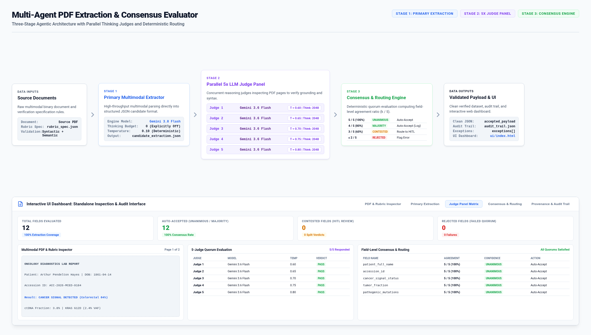

# Multi-Agent Document Extraction and Consensus Evaluator

A multi-agent document extraction and consensus evaluation system that extracts structured data from PDF files and images (including forms with handwritten text, checkboxes, and segmented character entries), evaluates candidate extractions using a parallel panel of five thinking-enabled LLM judges, and deterministically computes field-level consensus scores and routing decisions.

Compatible with AI agent harnesses supporting standard skill definitions (`SKILL.md`), plugin manifests (`plugin.json`), command-line execution, and standalone HTML dashboard inspection (`dashboard.html`).



---

## System Overview and Architecture

Automated document extraction in clinical, financial, and operational workflows requires consistent throughput and structured verification to prevent transcription errors, ungrounded values, field transpositions, and formatting discrepancies. This project implements a three-stage pipeline:

```
[Input Document (PDF/Image) + Target Extraction Rubric]
                       |
                       v
+---------------------------------------------------------+
| Stage 1: Primary Multimodal Extraction                  |
| - Default Model: gemini-3.8-flash (Thinking Budget: 0)  |
| - Low temperature (0.1) for deterministic field parsing |
| - Handles typed text, form layouts, and handwriting     |
| - Output: candidate_extraction JSON                     |
+--------------------------+------------------------------+
                           |
                           v
+---------------------------------------------------------+
| Stage 2: Parallel 5x LLM-as-a-Judge Panel               |
| - Default Model: 5x gemini-3.8-flash (Budget: 2048+)    |
| - Inputs: Source Document + Candidate JSON + Rubric     |
| - Concurrent asynchronous execution (asyncio.gather)    |
| - Evaluates visual grounding and handwriting accuracy   |
| - Output: 5 structured JudgeReport payloads             |
+--------------------------+------------------------------+
                           |
                           v
+---------------------------------------------------------+
| Stage 3: Deterministic Consensus and Routing Engine     |
| - Computes field agreement ratio (k / 5 passes)         |
| - Classifies status: UNANIMOUS_PASS, MAJORITY_PASS,     |
|   CONTESTED, or REJECTED                                |
| - Output: Validated JSON + Exceptions + dashboard.html  |
+---------------------------------------------------------+
```

### Stage Details

1. **Stage 1: Primary Multimodal Extraction (`pdf_consensus_evaluator/stage1_extractor.py`)**
   - Multimodal parsing using `gemini-3.8-flash` (configurable via `--extractor-model`) with `thinking_budget` set to `0`.
   - Processes form structures, tabular grids, fill-in-the-blank fields, checkboxes, and handwritten entries (print or cursive) alongside digital vector text.
   - Applies template subtraction and ink contrast rules to separate handwritten strokes from touching or overlapping printed form lines, comb dividers, and template labels.
   - Converts rubric extraction criteria into structured JSON schema instructions and emits a candidate JSON payload.

2. **Stage 2: Parallel LLM-as-a-Judge Panel (`pdf_consensus_evaluator/stage2_judge_panel.py`)**
   - Launches five concurrent, isolated judge evaluations using `gemini-3.8-flash` (configurable via `--judge-model`) with reasoning enabled (`thinking_budget: 2048` tokens) and staggered sampling temperatures.
   - Executes an **Adversarial Forensic Protocol** within the thinking budget: maps repeating template baseline and comb intervals, isolates pen strokes from pre-printed dividers, tests for optical conflation artifacts, and overturns erroneous candidate transcriptions.
   - Evaluates syntactic rules (data types, regular expressions, token counts, required fields) and visual semantic grounding against source document pages.
   - Attributes rejections to explicit failure modes (`TEMPLATE_INK_CONFLATION`, `HALLUCINATION`, `FORMAT_MISMATCH`, `FACILITY_ADDRESS_CONFUSED_AS_PATIENT`, `DIGIT_TRANSPOSITION`, `SECONDARY_CODE_EXTRACTED_AS_PRIMARY`, `ILLEGIBLE_HANDWRITING`, `CHECKBOX_MISINTERPRETED`).

3. **Stage 3: Deterministic Consensus and Routing (`pdf_consensus_evaluator/stage3_consensus.py`)**
   - Aggregates judge verdicts into field-level consensus metrics without additional model calls:

| Agreement Count (k / 5) | Status Classification | Confidence Band | Recommended Routing Action |
| :--- | :--- | :--- | :--- |
| 5 / 5 | `UNANIMOUS_PASS` | Very High Confidence (>=98%) | Auto-Accept |
| 4 / 5 | `MAJORITY_PASS` | High Confidence (90-95%) | Auto-Accept with Warning (log single dissent) |
| 3 / 5 | `CONTESTED` | Split Verdict (approx 60%) | Route to Human-in-the-Loop (HITL) |
| <= 2 / 5 | `REJECTED` | Low Confidence / Failure | Flag for Extraction Failure / Resubmission |

### Region-of-Interest Cropping, Morphological Line Suppression, and Comb Auto-Detection

Structured forms often use segmented character comb boxes with vertical dividers or baseline tick marks (for example, member IDs, postal codes, and account numbers). Downsampling full-page scans can cause small comb boxes (`<1.5%` of page area) to blend printed tick marks with adjacent pen strokes (such as misreading an open `'C'` or `'o'` touching a vertical tick mark as `'4'` or `'a'`).

To prevent template-ink conflation while preserving normal processing for typed documents:

1. **Stage Separation**:
   - **Stage 1 (Primary Extractor)** runs with `thinking_budget: 0` for fast initial extraction.
   - **Stage 2 (Judge Panel)** combines `thinking_budget: 2048+` with region-of-interest image preprocessing (`utils/comb_filter.py`) for independent forensic verification.
2. **Region-of-Interest Cropping (`crop_field_roi`)**:
   - Rubric criteria specify `field_type: "segmented_comb_box"` and optional normalized coordinates `bounding_box: [ymin, xmin, ymax, xmax]`, cropping at native scan resolution with 3% boundary padding.
3. **Morphological Vertical Tick Suppression (`suppress_vertical_ticks`)**:
   - Isolates and bleaches thin vertical tick marks and dividers (`<= 2px`) to white (`255`) using morphological vertical kernels and run-length filtering while preserving thicker curved pen strokes (`>= 3px`).
4. **Automated Comb Box Localization (`auto_detect_comb_rois`)**:
   - Uses horizontal and vertical pixel projection profiles to detect segmented comb rows when `bounding_box` coordinates are omitted from the rubric.
5. **Adversarial Comb Overturn**:
   - Judges perform a blind ink trace on the cleaned crop prior to inspecting the candidate string, overturning conflated characters with `failure_mode: "TEMPLATE_INK_CONFLATION"` and supplying the corrected value.

---

## Interactive UI Dashboard (`dashboard.html`)

Pipeline execution generates a single self-contained HTML file at `dashboard.html` adhering to `DESIGN.md` specifications. It opens directly from disk in any standard web browser and also supports live Server-Sent Events (`/events`) and in-browser file loading across five tabs:

1. **Document & Rubric Inspector**: Multi-page PDF viewer (page navigation, zoom controls, and embedded fallback) or image viewer alongside the searchable `Verification Rubric Specification` table.
2. **Primary Extraction**: Stage 1 candidate JSON payload, model and token parameters, flat `Extracted Field Breakdown` table, and 2D `Extracted Field Completeness & Structure` chart.
3. **Judge Panel Matrix**: `Judge x Field Verification Heatmap`, 2D `Judge Execution Latency & Pass Rate` chart, and 5-column `Parallel LLM Judge Evaluation Matrix` with interactive verdict details.
4. **Consensus & Routing**: Summary metrics strip, 2D `Field Agreement Ratios` chart, pan/zoom SVG `Interactive Relationship Node Map`, `Field-Level Consensus & Routing Table`, `Validated Clean Output Payload`, and `Exceptions & Dissent Ledger`.
5. **Provenance & Audit Trail**: `Provenance Audit Trail` table and complete JSON report viewer with copy and JSON download controls.

Additional interactive controls:
- **Model Configuration & Command Builder**: Editable text fields for Stage 1 Extractor Model, Stage 2 Judge Model, Thinking Budget, and Judge Count backed by `<datalist>` suggestions discovered from active credentials, generating copyable `/pdf-llm-as-judge` and CLI commands for any current or future model ID.
- **Load Run / PDF & Drag-and-Drop**: Load new `.json` evaluation reports, `.pdf` documents, or image scans directly in the browser without restarting or rebuilding.
- **Segmented Theme Selector**: Switch between Light, Dark, and System modes with `localStorage` persistence and real-time operating system theme synchronization.

---

## Directory Structure

All paths below are relative to the project root directory:

```text
.
|-- .gitignore                                                  # Git ignore rules
|-- DESIGN.md                                                   # Dashboard visual and technical specification
|-- LICENSE                                                     # Apache License 2.0
|-- README.md                                                   # Project documentation and user guide
|-- SKILL.md                                                    # Agent skill definition and workflow instructions
|-- dashboard.html                                              # Standalone interactive HTML evaluation dashboard
|-- plugin.json                                                 # Agent plugin registration manifest
|-- prd.md                                                      # Product Requirements Document
|-- pyproject.toml                                              # Python package configuration and dependencies
|-- assets/
|   `-- pipeline_workflow_dashboard.png                         # Pipeline architecture and dashboard overview diagram
|-- output/
|   `-- test_cancer_screening_evaluation.json                   # Sample 5-judge consensus evaluation report
|-- pdf_consensus_evaluator/
|   |-- __init__.py                                             # Package root and public exports
|   |-- cli.py                                                  # Command-line argument parser and entry point
|   |-- dashboard_generator.py                                  # Standalone HTML dashboard generator
|   |-- gemini_client.py                                        # Multimodal API client with retry and auth resolution
|   |-- models.py                                               # Dataclasses, schemas, and enumerations
|   |-- pipeline.py                                             # Three-stage pipeline orchestrator
|   |-- stage1_extractor.py                                     # Stage 1 primary multimodal extractor
|   |-- stage2_judge_panel.py                                   # Stage 2 parallel 5x thinking judge panel
|   `-- stage3_consensus.py                                     # Stage 3 deterministic consensus and routing engine
|-- samples/
|   |-- cancer_screening_lab_report.jpg                         # Synthetic molecular diagnostics report (JPEG image)
|   |-- cancer_screening_lab_report.pdf                         # Synthetic molecular diagnostics report (vector PDF)
|   |-- cancer_screening_lab_report_degraded.pdf                # Synthetic degraded image-only scan PDF
|   |-- cancer_screening_lab_report_scanned.pdf                 # Synthetic flatbed-scanned image-only PDF
|   |-- expected_candidate_cancer_screening_lab_report.json     # Reference candidate extraction for lab report
|   |-- expected_candidate_cancer_screening_lab_report_degraded.json # Reference candidate for degraded scan
|   |-- expected_candidate_healthcare_patient_intake_form.json  # Reference candidate extraction for intake form
|   |-- healthcare_patient_intake_form.pdf                      # Synthetic patient intake form PDF
|   |-- rubric_spec_cancer_screening_lab_report.json            # Verification rubric for molecular lab report
|   `-- rubric_spec_healthcare_patient_intake_form.json         # Verification rubric for patient intake form
|-- scripts/
|   |-- evaluate_candidate.py                                   # CLI script for Stage 2 + Stage 3 candidate evaluation
|   `-- run_pipeline.py                                         # CLI script for full end-to-end pipeline execution
|-- tests/
|   |-- __init__.py                                             # Test suite package initializer
|   |-- test_comb_filter.py                                     # ROI cropping and comb-line suppression tests
|   |-- test_consensus.py                                       # Consensus vote aggregation and degraded quorum tests
|   |-- test_models.py                                          # Rubric and model serialization tests
|   |-- test_pipeline_e2e.py                                    # End-to-end pipeline and dashboard specification tests
|   |-- test_stage1_and_judge_prompts.py                        # Extractor and forensic judge prompt tests
|   `-- test_synthetic_discrepancies.py                         # Synthetic error injection and rejection tests
`-- utils/
    |-- __init__.py                                             # Utilities package initializer
    `-- comb_filter.py                                          # ROI cropping and morphological tick suppression
```

---

## User Guide for Non-Technical Users

This guide explains how to use the skill to read and verify information from everyday documents -- such as patient intake packets, laboratory reports, insurance forms, and scanned registration cards -- without writing code.

### What Problem This Solves

When a single automated reader scans a form or PDF, small mistakes can slip through unnoticed: two digits in an identification number might be swapped, a clinic's street address might be copied into the patient's home address field, or a handwritten letter touching a printed box border might be misread.

Instead of relying on a single automated pass, this skill uses a two-layer review process modeled after an independent audit panel:
1. **Initial Reader**: One reader extracts all requested fields from your PDF or image.
2. **Five Independent Reviewers (Judges)**: Five separate AI reviewers inspect the original document pages at the same time and check every extracted value against your checklist (called a **rubric**).
3. **Clear Voting Rules**:
   - **5 of 5 reviewers agree (`UNANIMOUS_PASS`)**: Accepted automatically.
   - **4 of 5 reviewers agree (`MAJORITY_PASS`)**: Accepted automatically, while recording the single reviewer's note.
   - **3 of 5 reviewers agree (`CONTESTED`)**: Flagged for a human team member to check, showing both sides' notes.
   - **2 or fewer reviewers agree (`REJECTED`)**: Rejected so an inaccurate value is not entered into downstream records.

### Real-World Examples

#### Example 1: Verifying a Patient Intake Form (PDF)
Suppose a clinic front desk receives a completed multi-page patient intake PDF (`samples/healthcare_patient_intake_form.pdf`) and wants to verify the patient's legal name, date of birth, residential address, Social Security number, insurance member ID, and diagnosis code against `samples/rubric_spec_healthcare_patient_intake_form.json`.

1. **Type the following message into your AI assistant chat**:
   ```text
   /pdf-llm-as-judge samples/healthcare_patient_intake_form.pdf samples/rubric_spec_healthcare_patient_intake_form.json
   ```
2. **Read the plain-language summary**:
   The assistant lists each extracted field alongside its vote count (for example, `5/5` agreement) and flags any field that needs human attention.
3. **Inspect the visual dashboard**:
   Double-click `dashboard.html` in the project folder to view the original intake form on the left and the field-by-field verification rules and reviewer notes on the right.

#### Example 2: Checking a Photo or Scan of a Laboratory Report (JPEG or PNG)
Suppose a care coordinator has a JPEG scan of a molecular lab report (`samples/cancer_screening_lab_report.jpg`) rather than a digital PDF, and wants to confirm that biomarker scores, tumor fraction percentages, and gene variants were read accurately without confusing patient IDs with specimen accession numbers.

1. **Send the command in chat**:
   ```text
   /pdf-llm-as-judge samples/cancer_screening_lab_report.jpg samples/rubric_spec_cancer_screening_lab_report.json
   ```
2. **Review the verified results**:
   All five reviewers verify that the patient's Medical Record Number was not mixed up with the lab Accession ID and that only detected mutations were included.
3. **Zoom into the scan**:
   Open `dashboard.html` and use the `+`, `-`, and `100%` zoom buttons in Tab 1 (`1. Document & Rubric`) to compare the scanned image directly against the extracted values.

#### Example 3: Reading Handwritten Entries in Character Boxes
Suppose an applicant fills out an identification number by hand inside pre-printed character boxes where pen strokes touch the small vertical divider ticks. A basic scanner might misread a curved handwritten `C` touching a tick mark as the number `4`.

1. **Run the same command on the scanned form**:
   ```text
   /pdf-llm-as-judge samples/healthcare_patient_intake_form.pdf samples/rubric_spec_healthcare_patient_intake_form.json
   ```
2. **Automatic Cleanup and Independent Cross-Check**:
   Behind the scenes, the skill crops the character boxes at full resolution, removes the thin printed divider lines while keeping the pen ink intact, and asks all five reviewers to trace the handwriting independently.
3. **Error Catching**:
   If the initial reader mistook a character because of a printed box line, the reviewers flag `TEMPLATE_INK_CONFLATION` and provide the corrected characters in Tab 4 (`4. Consensus & Routing`).

#### Example 4: Loading Another Document or Changing AI Models in `dashboard.html`
1. Open `dashboard.html` in any web browser.
2. **To inspect a different completed report or PDF**: Click **Load Run / PDF** in the top bar (or drag and drop a `.json` report and `.pdf` / image file onto the page). All charts, tables, and the document viewer update immediately.
3. **To switch to a newer AI model**: In the **Model Configuration** bar near the top of `dashboard.html`, type or select the desired model name in **Stage 1 Extractor Model** or **Stage 2 Judge Model**, then click **Copy /pdf-llm-as-judge** and paste that command into your AI assistant chat.

---

## Data Privacy and Synthetic Data Notice

All sample files in `samples/` and `output/` are synthetic datasets created strictly for testing and demonstration. They contain no real personal data or Protected Health Information (PHI).

---

## Installation and Prerequisites

### Requirements
- Python `3.10` or higher
- Python packages: `requests`, `pypdf`, `pyyaml` (plus `Pillow`, `numpy`, and `pytest` for image filtering and test execution)

### Setup and Authentication

1. Open a terminal in the project root directory:
   ```bash
   pip install -e ".[dev]"
   ```

2. Configure authentication using either Application Default Credentials (ADC) or an API key:

   #### Option A: Application Default Credentials (ADC)
   ```bash
   gcloud auth application-default login
   ```
   Optional environment overrides when using cloud project routing:
   ```bash
   export VERTEX_PROJECT="your-project-id"
   export VERTEX_LOCATION="us-central1"
   ```

   #### Option B: API Key Authentication
   ```bash
   export GEMINI_API_KEY="your-api-key"
   ```
   Alternatively, pass `--api-key <key>` directly to the CLI scripts.

---

## Command-Line Usage

### 1. Run the Full Extraction and Consensus Pipeline

```bash
python3 scripts/run_pipeline.py \
  --document samples/healthcare_patient_intake_form.pdf \
  --rubric samples/rubric_spec_healthcare_patient_intake_form.json \
  --output output/extraction_report.json \
  --dashboard dashboard.html
```

`--image` and `--pdf` are also accepted as aliases for `--document`.

### 2. Evaluate an Existing Candidate Extraction JSON

To run Stage 2 (5x Judge Panel) and Stage 3 (Consensus Engine) on an existing candidate JSON file without re-running Stage 1:

```bash
python3 scripts/evaluate_candidate.py \
  --document samples/healthcare_patient_intake_form.pdf \
  --rubric samples/rubric_spec_healthcare_patient_intake_form.json \
  --candidate-json samples/expected_candidate_healthcare_patient_intake_form.json \
  --output output/evaluation_report.json \
  --dashboard dashboard.html
```

### 3. CLI Reference

| Flag | Type | Default | Description |
| :--- | :--- | :--- | :--- |
| `--document`, `--image`, `--pdf` | String | Required | Relative or local path to input document (`.pdf`, `.jpeg`, `.jpg`, `.png`, `.webp`, `.heic`) |
| `--rubric` | String | Required | Path to JSON rubric specification file |
| `--candidate-json` | String | `None` | Pre-extracted candidate JSON (skips Stage 1 extraction) |
| `--output` | String | `None` | File path to write structured JSON report |
| `--dashboard` | String | `dashboard.html` | File path to write standalone HTML dashboard |
| `--no-dashboard` | Flag | `False` | Disable HTML dashboard generation |
| `--api-key` | String | `None` | Explicit API key (overrides `GEMINI_API_KEY`) |
| `--extractor-model` | String | `gemini-3.8-flash` | Model identifier for Stage 1 extraction |
| `--judge-model` | String | `gemini-3.8-flash` | Model identifier for Stage 2 judge panel |
| `--thinking-budget` | Integer | `2048` | Reasoning token budget per judge |
| `--num-judges` | Integer | `5` | Number of concurrent judges in panel |
| `--min-pass-ratio` | Float | `0.8` | Minimum pass ratio for automatic acceptance |
| `--verbose`, `-v` | Flag | `False` | Enable debug logging |

---

## Using the Skill in an Agent Harness

1. **Slash Command Invocation**:
   ```text
   /pdf-llm-as-judge samples/cancer_screening_lab_report.pdf samples/rubric_spec_cancer_screening_lab_report.json
   ```

2. **Pass Rubric Paths as Text Arguments**:
   **Important:** Reference JSON rubric paths directly in your prompt text (for example, `samples/rubric_spec_cancer_screening_lab_report.json`) rather than attaching `.json` files as binary media uploads, since multimodal generation endpoints reject `application/json` inline media attachments with `HTTP 400`.

3. **Customizing Models and Reasoning Budgets**:
   ```text
   /pdf-llm-as-judge samples/cancer_screening_lab_report.pdf samples/rubric_spec_cancer_screening_lab_report.json --extractor-model gemini-2.5-pro --judge-model gemini-2.5-pro --thinking-budget 4096 --num-judges 5
   ```

---

## Running the Automated Test Suite

Execute all unit, integration, synthetic error injection, comb filter, and dashboard compliance tests with `pytest`:

```bash
pytest -v tests/
```

Test modules:
- `tests/test_models.py`: Rubric parsing, syntactic constraints, and judge deserialization.
- `tests/test_consensus.py`: Consensus scoring across agreement ratios (`5/5` to `0/5`), degraded quorums, and phantom dissent reconciliation.
- `tests/test_comb_filter.py`: Normalized ROI cropping, vertical tick suppression, HSV color filtering, and comb auto-detection.
- `tests/test_stage1_and_judge_prompts.py`: Stage 1 template subtraction prompts, Stage 2 Adversarial Forensic Protocol, and failure modes.
- `tests/test_synthetic_discrepancies.py`: Rejection of injected SSN errors, clinic address confusions, and date transpositions.
- `tests/test_pipeline_e2e.py`: End-to-end execution across PDF and JPEG inputs, `DESIGN.md` compliance checks, and dynamic model discovery fallback tests.

---

## Rubric and Output Schemas

### Sample Rubric Specification (`RubricSpec`)

```json
{
  "rubric_version": "2.0",
  "document_type": "Healthcare_Patient_Intake_Form",
  "extraction_criteria": [
    {
      "field_name": "patient_full_name",
      "syntactic_rules": {
        "required": true,
        "type": "string",
        "min_tokens": 2
      },
      "semantic_grounding_rules": {
        "source_section": "SECTION 1: PATIENT IDENTIFICATION",
        "verification_criteria": "Must match the patient's legal name. Do not accept preferred nicknames.",
        "failure_modes": [
          "PREFERRED_NAME_CONFUSED_WITH_LEGAL",
          "NAME_TRUNCATED",
          "HALLUCINATION"
        ]
      }
    }
  ]
}
```

### Sample Output Report (`PipelineReport`)

```json
{
  "document_type": "Healthcare_Patient_Intake_Form",
  "rubric_version": "2.0",
  "timestamp": "2026-09-09T00:09:12.190712+00:00",
  "total_fields": 6,
  "accepted_field_count": 6,
  "contested_field_count": 0,
  "rejected_field_count": 0,
  "quorum_metadata": {
    "requested_judges": 5,
    "successful_judges": 5,
    "quorum_degraded": false,
    "judge_errors": []
  },
  "candidate_extraction": {},
  "accepted_payload": {
    "patient_full_name": "Eleanor Vance Sterling",
    "date_of_birth": "1984-11-23",
    "social_security_number": "987-65-4320",
    "residential_address": {
      "street": "742 Evergreen Terrace, Apt 3B",
      "city": "St. Paul",
      "state": "MN",
      "zip_code": "55102"
    },
    "insurance_member_id": "XMN-849201840-01",
    "primary_diagnosis_code": "C50.912"
  },
  "exceptions": [],
  "consensus_breakdown": {
    "patient_full_name": {
      "agreement_count": 5,
      "total_judges": 5,
      "agreement_ratio": "5/5 (100%)",
      "status": "UNANIMOUS_PASS",
      "confidence_band": "Very High Confidence (>=98%)",
      "routing_action": "Auto-Accept"
    }
  },
  "audit_trail": []
}
```

---

## License

This project is licensed under the Apache License, Version 2.0. See the [LICENSE](LICENSE) file for the full license text and terms.
